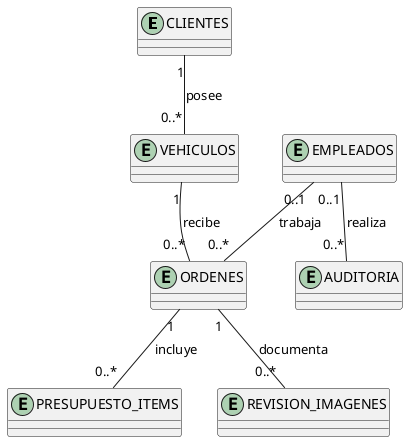

# Sistema de gestión para taller mecánico

Aplicación web para registrar clientes, vehículos y órdenes de trabajo de un taller mecánico. Cada orden representa un ingreso o revisión del vehículo y conserva su motivo, estado, observaciones, imágenes y presupuesto.

## Tecnologías

- HTML, CSS y JavaScript (interfaz de página única).
- PHP 8 con sesiones y una API JSON.
- MySQL/MariaDB mediante PDO.

El navegador usa `fetch` para enviar solicitudes a `api.php`. PHP valida y procesa los datos, consulta la base con PDO y devuelve respuestas JSON que JavaScript presenta en la interfaz.

El JavaScript del frontend está separado por responsabilidades: `public/js/clientes.js`, `vehiculos.js`, `ordenes.js` y `empleados.js` contienen las secciones del sistema; `public/js/app.js` reúne las funciones compartidas, la navegación y el arranque. `public/index.html` carga primero los módulos de sección y al final `app.js`.

En el backend, `api.php` inicia la sesión, prepara los datos de la petición, valida el acceso y deriva cada acción a `controllers/`. Las operaciones de clientes, vehículos, órdenes y empleados están separadas por archivo; las funciones compartidas para cargar imágenes están en `includes/uploads.php`.

## Funcionalidades

- Registro e inicio de sesión de empleados; las contraseñas se guardan cifradas con `password_hash`.
- Alta, consulta, edición y baja lógica de clientes, vehículos y órdenes.
- Fichas técnicas de vehículos vinculadas a sus clientes.
- Órdenes con técnico, motivo de ingreso, estado, reparación, observaciones y fechas.
- Imagen principal del vehículo y varias imágenes JPG/PNG para las observaciones.
- Presupuesto detallado por piezas y mano de obra.
- Búsqueda y filtros de clientes y vehículos.
- Resumen de órdenes y actividad reciente.
- Trazabilidad de altas, modificaciones y bajas.
- Ficha de orden para imprimir, guardar como PDF desde el navegador o descargar en formato compatible con Word.

## Modelo de datos

El esquema de instalación está en [`database/schema.sql`](database/schema.sql).



Un cliente puede tener varios vehículos; cada vehículo puede tener varias órdenes. Las piezas, la mano de obra y las imágenes de observación se relacionan con una orden. La auditoría registra las acciones y, cuando corresponde, el empleado que las realizó.

## Requisitos

- PHP 8 con las extensiones `pdo_mysql` y `fileinfo`.
- MySQL o MariaDB.
- Apache (por ejemplo, XAMPP) o el servidor integrado de PHP.

## Instalación local

1. Importar [`database/schema.sql`](database/schema.sql) en MySQL/MariaDB. El archivo crea la base `taller_mecanico_v2`.
2. Revisar la conexión en [`config/database.php`](config/database.php). Por defecto usa `127.0.0.1`, base `taller_mecanico_v2`, usuario `root` y contraseña vacía. También acepta `DB_HOST`, `DB_NAME`, `DB_USER` y `DB_PASSWORD`.
3. Desde la carpeta raíz del proyecto, iniciar el servidor integrado:

   ```bash
   php -S localhost:8001
   ```

4. Abrir <http://localhost:8001/public/index.html>.
5. Crear una cuenta de empleado desde **Crear cuenta** e iniciar sesión.

En XAMPP, colocar el proyecto dentro de `htdocs`, iniciar Apache y MySQL, importar el esquema y abrir la ruta local equivalente.

## Uso básico

1. En **Clientes**, pulsar **+ Cliente** y guardar los datos del cliente.
2. En **Vehículos**, pulsar **+ Vehículo**, seleccionar el cliente e ingresar los datos técnicos del vehículo.
3. Completar el motivo de ingreso, la observación, las imágenes y los datos del presupuesto; guardar la ficha para crear la orden.
4. En **Órdenes**, editar el estado, el técnico, la reparación, las observaciones o el presupuesto.
5. Usar el ícono de impresora de una orden para abrir la ficha imprimible. Desde esa ficha se puede imprimir o guardar como PDF, o descargar la copia compatible con Word.

## Decisiones y límites conocidos

- Se eligió PHP para la lógica del servidor por su integración directa con el entorno Apache/XAMPP y MySQL usado en la cursada.
- Las bajas se conservan mediante `fecha_baja`; no se borran físicamente los registros principales.
- Las imágenes admitidas son JPG/JPEG y PNG, con un límite de 5 MB por imagen.
- La descarga para Word es un documento HTML con extensión `.doc`, no un archivo `.docx`.

## Autoría académica

- **Autor:** Gabriel Benitez
- **Asignatura:** Programación III
- **Carrera:** Análisis y Desarrollo de Software
- **Institución:** Instituto Gaspar L. Benavento

## Uso de inteligencia artificial

Se utilizó inteligencia artificial como asistencia durante el desarrollo y los ajustes del proyecto, incluido el diseño visual de `public/css/styles.css`. El archivo de estilos identifica esta asistencia en un comentario.

[Conversación de IA sobre la ficha imprimible y los estilos](https://gist.github.com/bryelttz/879c7babb6625b3ff0e3fac15fdf904a)

La consigna también solicita identificar con comentarios los bloques asistidos por IA y que estos no superen el 15 % del código total. Esta declaración y el enlace no certifican por sí solos ese porcentaje; debe revisarse antes de la entrega.

## Licencia

Este proyecto se distribuye bajo la licencia MIT. Consultar [`LICENSE`](LICENSE).
